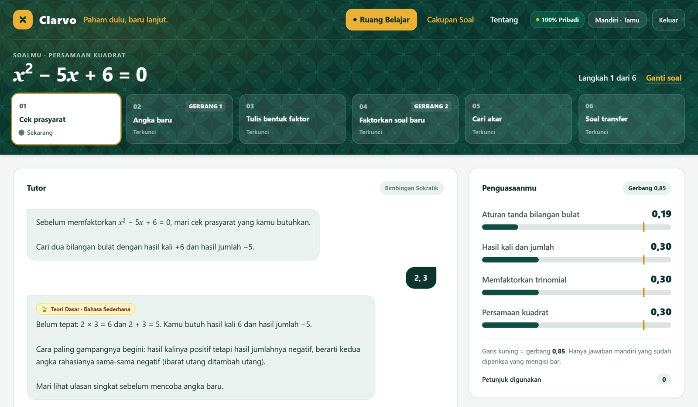
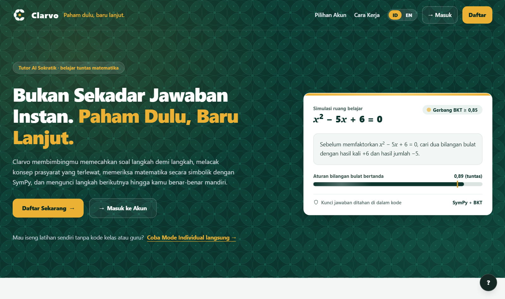
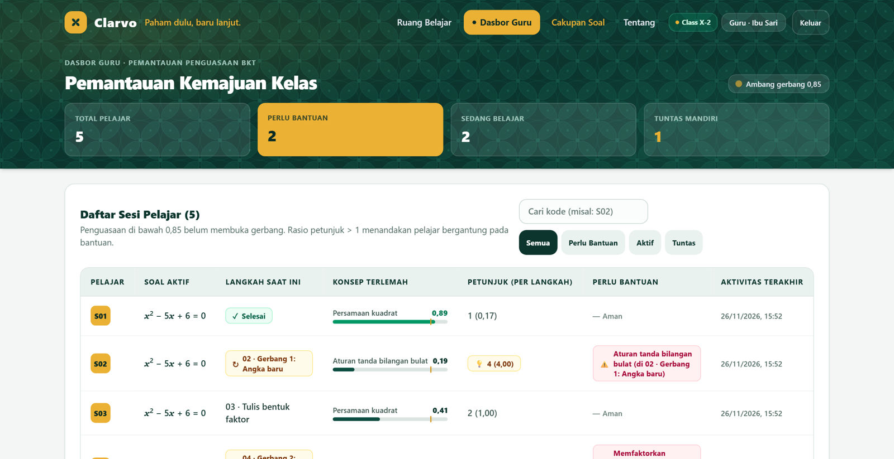

<div align="center">

<picture>
  <source media="(prefers-color-scheme: dark)" srcset="docs/images/clarvo-logo-light.svg">
  
</picture>

# Clarvo

*Earn the next step.*

[](LICENSE)
[](https://laravel.com)
[](https://livewire.laravel.com)
[](https://www.sympy.org)

[Features](#what-it-does) • [How it works](#how-it-works) • [Setup](#setup) • [Licence](#licence)

</div>

Clarvo is a math tutor that will not hand you the answer. It breaks a problem into steps, checks every answer with a symbolic math engine, and opens the next step only when your mastery of the concept says you are ready. Teachers see where each learner is stuck; private learners stay invisible to everyone but themselves. Built in Laravel 13 and Livewire 4 for the NEC 6 essay competition.

<p align="center">
  
</p>

## Ringkasan

Clarvo adalah purwarupa tutor matematika untuk pelajar sekolah dan mahasiswa tahun pertama. Soal dipecah menjadi langkah-langkah, dan gerbang ke langkah berikutnya baru terbuka setelah penguasaan konsep mencapai 0,85 menurut Bayesian Knowledge Tracing. Jawaban diperiksa secara deterministik oleh SymPy. Model bahasa (Gemini, opsional) hanya memparafrase umpan balik dan teori singkat, dan tidak pernah menerima kunci jawaban. Slogan bahasa Indonesianya: *Paham dulu, baru lanjut.*

## Why

A chatbot that answers everything makes practice look better than it is. In a field experiment with nearly 1,000 high-school students, those who practised with plain GPT-4 scored 48% higher during practice and 17% lower on the exam without it (Bastani et al., 2025, *PNAS*). Indonesia adds a second problem: many learners reach quadratics without the integer and sign skills underneath them.

So Clarvo does three things a chat window does not. It traces a problem back to its prerequisites and checks those first. It decides who moves on in code, from mastery scores, so no prompt can talk it into skipping a step. And it lets a language model reword feedback, never grade it or reveal it.

## Screenshots

| Landing | Teacher dashboard |
|---|---|
|  |  |

## What it does

A learner enters a problem, or picks an example, and works through it step by step.

**Quadratic equations** take six steps:

| Step | What the learner does | Scored |
|---|---|---|
| 1. Prerequisite check | Finds two integers with a given product and sum | yes |
| 2. Gate 1: new numbers | Does the same with fresh numbers | yes |
| 3. Write the factor form | Factors their own equation, with guidance | no |
| 4. Gate 2: factor a new one | Factors a new trinomial without help | yes |
| 5. Find the roots | Reads the roots off the factor form | no |
| 6. Transfer problem | Solves a new equation from start to finish | yes |

**Other topics** take four steps (a check, a gate with new numbers, a guided step, and a transfer problem): linear equations, modulo, division with remainder, and basic formulas such as percentages, Pythagoras, area, square roots, powers and arithmetic with brackets.

- **Gates.** A gate opens when the mastery estimate for its concept reaches 0.85. On scored steps, only answers given without a hint and checked by SymPy move the estimate.
- **Adaptive theory.** Before each step the tutor gives a short explanation at one of three levels (simple, standard, advanced), chosen from the learner's mastery, recent mistakes and hint use.
- **Hints, never answers.** The learner can ask for a hint at any step. The tutor never shows the final answer.
- **Review before retrying.** A wrong answer at step 1, or three wrong answers at a gate, leads to a short review and then new numbers. After three wrong answers the teacher dashboard flags the learner.
- **Three ways in.** Students join with a class code and a learner code (optionally a PIN). Teachers sign in with email and password. Individual learners sign in or continue as a guest; their sessions are private.
- **Teacher dashboard.** One row per learner in non-private classes: current step, weakest concept, hints per step, and a "needs help" flag, with filters and search. It refreshes every 15 seconds.

## How it works

```
Browser
  │
  ▼
Laravel 13 + Livewire 4  (port 8000, SQLite)
  │                  │
  ▼                  ▼
SymPy service        Gemini API
FastAPI, port 8001   optional
```

| Part | Where | Job |
|---|---|---|
| Gate controller | `app/Services/Tuntas/GateControllerService.php` | Runs the steps, scores answers, opens gates |
| Mastery model | `app/Services/Tuntas/BktEngineService.php` | Bayesian Knowledge Tracing: learn 0.15, slip 0.10, guess 0.20, starting mastery 0.30 |
| Answer checker | `sympy-service/main.py` | Checks answers symbolically. Laravel calls `POST /verify` with a shared secret |
| Item generator | `app/Services/Tuntas/IsomorphicItemGeneratorService.php` | Parses each topic and makes new problems of the same kind for gates and reviews |
| Adaptive theory | `app/Services/Tuntas/AdaptiveTheoryService.php` | Builds the explanations, hints and reviews at the chosen level |
| Feedback wording | `app/Services/Tuntas/GeminiSocraticService.php` | Optionally rewords feedback with Gemini, then `isSafe()` rejects any reply that adds numbers, roots, factors or sign words |
| Sign-in | `app/Services/Tuntas/TuntasAuthService.php` | Student, teacher and individual accounts |
| Screens | `resources/views/pages/tuntas/` | Landing (`/`), learning space (`/workspace`) and teacher dashboard (`/teacher`) |

## Privacy

- Students are known only by a learner code such as `S01`. Individual learners get a random private code and never appear on a teacher dashboard.
- Answer text is never written to the database. Each attempt is logged with its result and mastery change only.
- The tutor conversation lives in the page's memory and is gone when the page closes.
- Gemini receives only the text Clarvo has already written, never the answer key.
- Individual sign-up asks the learner to confirm they are 18 or older, or that a parent or guardian has agreed. Indonesia's Personal Data Protection Law (UU No. 27 Tahun 2022) requires a parent's or guardian's consent before a child's data is processed. Guest mode stores no name or email.
- Class learners are known only by their code. Before a class uses Clarvo with real students, agree on consent with the school and the parents.
- `php artisan migrate:fresh --seed` creates demo sign-ins whose password is written in the code. The seeder skips them when `APP_ENV=production`, and the sign-in form hides the "Isi Demo" buttons there.

## Requirements

- PHP 8.4.1 or newer, with `pdo_sqlite`, `curl`, `openssl` and `mbstring`. The Symfony 8 packages in `composer.lock` refuse older versions, so the PHP 8.2 bundled with XAMPP is not enough.
- Composer
- Node.js (LTS)
- Python 3.10 or newer, for the SymPy service

## Setup

From the project folder:

```bash
cp .env.example .env
composer install
npm install
php artisan key:generate
```

Create an empty `database/database.sqlite`, then set these in `.env`:

| Variable | Required | Notes |
|---|---|---|
| `SYMPY_API_SECRET` | yes | Any random string. The SymPy service rejects every request while it is empty. The service reads it from this same `.env`. |
| `GEMINI_API_KEY` | no | From Google AI Studio. Without it, feedback and explanations are shown exactly as Clarvo writes them. |

Build the database with the demo class (learners `S01` to `S05` in `Class X-2`), a demo teacher and a demo individual learner:

```bash
php artisan migrate:fresh --seed
```

The demo sign-ins are in `database/seeders/ClassDemoSeeder.php`.

## Running

Clarvo needs two processes, each in its own terminal.

**SymPy service**, from `sympy-service`:

```bash
python -m venv venv
venv\Scripts\activate          # Windows
source venv/bin/activate       # macOS and Linux
pip install -r requirements.txt
uvicorn main:app --port 8001
```

**Web app**, from the project folder:

```bash
npm run build
php artisan serve
```

Then open http://127.0.0.1:8000/ and sign in, or continue as a guest.

## Tests

```bash
php artisan test
```

The SymPy service has its own tests. With its `venv` active, from `sympy-service`:

```bash
python -m unittest -v
```

## Troubleshooting

| Symptom | Cause | Fix |
|---|---|---|
| Every answer says the checker can't be reached | The SymPy service isn't running, or `SYMPY_API_SECRET` is empty | Start the service on port 8001 and set the secret |
| Gemini fails with `cURL error 60` on Windows | PHP has no CA certificate bundle | Point `curl.cainfo` in `php.ini` at a `cacert.pem`. For local testing only, `GEMINI_VERIFY_TLS=false` skips the check |
| `composer install` fails on the PHP version | PHP older than 8.4.1 | Install PHP 8.4.1 or newer |
| Pages have no styling | Assets not built | Run `npm run build` |

## Status

This is a prototype for a competition entry, not a finished product. Known limits:

- The interface is in Indonesian only.
- The privacy notes above are a starting point for a school trial, not legal advice.
- A teacher sees every learner in a non-private class, not only the learners in their own class.
- Mastery parameters are illustrative and have not been fitted to real learner data.

## Contributing

Work goes through pull requests into `main`. The project lead reviews and merges. Before opening one, run `php artisan test`, and `vendor/bin/pint` on the files you changed. GitHub Actions runs both test suites on every pull request and checks the changed PHP files with Pint.

## Licence

Copyright (C) 2026 Clarvo contributors.

Clarvo is free software under the GNU Affero General Public License, version 3 or (at your option) any later version. See [LICENSE](LICENSE). If you run a modified Clarvo for other people over a network, you must offer them its source code. The "Kode sumber" link in the footer does this for the hosted app.

The licence covers the code. It does not give permission to use the Clarvo name or logo for a different product.

### Third-party software

| Component | Licence |
|---|---|
| Laravel, Livewire, Alpine.js, Tailwind CSS | MIT |
| FastAPI, Pydantic | MIT |
| Uvicorn, python-dotenv, SymPy | BSD-3-Clause |
| Instrument Sans typeface | SIL Open Font License 1.1 |

Gemini is an external service used under Google's terms.

---

Last reviewed: 26 November 2026
